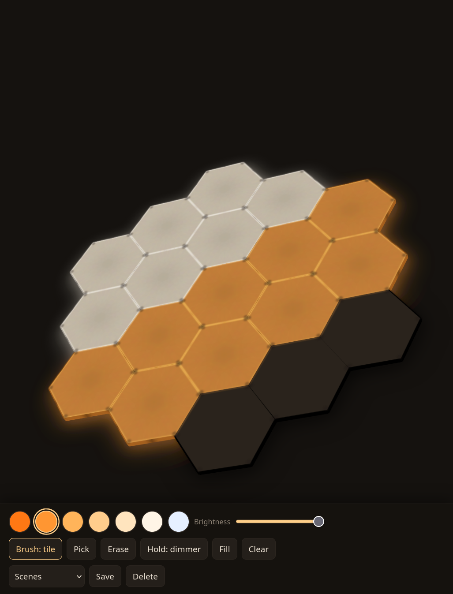

# hexlore

Paint and animate a Nanoleaf Elements hexagon wall from a browser, and make the
tiles react when you touch them. Everything runs on your own network: no cloud
account, no Nanoleaf app after pairing, and nothing to install besides Node.

<p align="center">
  
</p>

hexlore is also a record of how the panels work. Much of it is not in Nanoleaf's
documentation and was found by experiment, such as how a tile's touch sensor is
identified. The notes are in `agent_docs/` and on a reference page served by the
app.

## What you can do

- **Paint each tile corner by corner.** Every hexagon has six LEDs, one per
  corner, and the app lets you set each one. A 3D preview shows roughly how the
  wall will look, including how light spreads through a tile and leaks at its rim.
- **Touch the wall.** Tiles can glow as your hand approaches, send a ripple across
  the wall, or take the current brush color when you tap them. New tiles are
  recognized automatically; there is no calibration step.
- **Run animations.** Rain, fireworks, a bouncing ball, pinwheels, a heartbeat, a
  full lunar cycle and more, picked from the app or started from the command line.
  Each effect is one small file, so adding your own is straightforward.
- **Save scenes**, undo and redo, and control panel brightness.
- **Try it without hardware.** A simulator mode lets you build a tile layout in
  the browser and paint it.

## Getting started

You need Node and an Elements controller on the same network.

1. Pair with the controller:

   ```bash
   node src/hexlore.mjs pair
   ```

   It finds the controller on your network, then asks you to hold the
   controller's power button for 5 to 7 seconds until its LEDs flash. The access
   token and the controller's address are saved to `token.json`. Keep that file
   private: anyone with it can control your lights.

2. Start the app:

   ```bash
   node src/server.mjs
   ```

3. Open `http://<this machine>:8321` on a phone or computer on the same network.

If the controller isn't found, pass its address from your router's device list:
`node src/hexlore.mjs pair --ip <address>`. If its address changes later, run
`node src/hexlore.mjs find` to see the new one and pair again.

Stopping the app with Ctrl-C puts back the effect the panels were showing before.

To explore without a device: `node src/server.mjs 8322 --sim`.

## Controlling the panels from the command line

```bash
node src/hexlore.mjs status          # name, firmware, power, brightness, current effect
node src/hexlore.mjs off             # and on
node src/hexlore.mjs brightness 40 2 # fade to 40% over 2 seconds
node src/hexlore.mjs ct 2700         # plain warm white
node src/hexlore.mjs effects         # the controller's built-in effects
node src/hexlore.mjs select Ember    # play one
node src/hexlore.mjs identify        # flash the panels
node src/hexlore.mjs touch           # watch touches live
```

`node src/hexlore.mjs help` lists the rest, including the tile layout and raw device
commands.

## hexlore's animations from the command line

The same animations the app offers, without the app:

```bash
node src/hexlore.mjs run             # what is available
node src/hexlore.mjs run rain 20     # run for 20 seconds, then restore the previous effect
node src/hexlore.mjs run moon --keep # leave the result up after Ctrl-C
```

Stop the app first; both stream to the same panels and would overwrite each other.

## Using the panels from your own code

`src/nanoleaf.mjs` is a single-file library the app itself is built on. It has no
dependencies and knows nothing about the app, so it can be copied into other
projects.

```js
import { Nanoleaf, discover, pair } from "./src/nanoleaf.mjs";

const [controller] = await discover();
const token = await pair(controller.ip);     // hold the power button meanwhile
if (!token) throw new Error("pairing timed out: hold the power button 5 to 7 s");
const nl = new Nanoleaf({ host: controller.ip, token });

const { tiles } = await nl.layout();         // tiles with their six corner zones
await nl.startStream();
nl.send(Object.fromEntries(tiles[0].corners.map((c) => [c.id, [255, 160, 60]])));

const stop = nl.touch(({ id, type, strength }) => console.log(id, type, strength));
```

It also covers brightness, effects, device events, the touch id of each tile and
raw device commands; see the comments at the top of the file.

## What hexlore documents

Verified on an NL52 controller with firmware 12.4.1:

- **Per-corner streaming.** The six LEDs of each tile are separate zones in the
  layout and can be driven individually over the extControl v2 UDP stream.
- **Raw touch data.** Besides gestures, the controller streams per-tile hover,
  down, hold, up and swipe events with a strength value, about 7 times a second.
- **Touch ids.** A tile reports touches under an id that does not appear in the
  public layout. That id follows from the tile's six corner ids through a CRC-16,
  which is how the app maps new tiles without asking you to touch them. The model
  was confirmed against tile layouts found in Nanoleaf's Android app, analyzed with
  [cupella](https://wistrand.github.io/cupella/).
- **Hardware notes.** Tile construction, how light spreads in a tile, where the
  controller sits, expansion and power limits, and the controller's other local
  commands, with sources and open questions marked.

The `/tiles` page in the running app summarizes the protocol and shows your own
tiles and their ids.

## Project layout

| Path          | Contents                                                          |
|---------------|-------------------------------------------------------------------|
| `src/`        | device library, server, pairing and effect tools, `effects/`      |
| `docs/`       | the browser app and the `/tiles` reference page                   |
| `data/`       | your painting, saved scenes and touch map; not version controlled |
| `media/`      | images for this README                                            |
| `agent_docs/` | protocol, hardware and troubleshooting notes                      |

No dependencies beyond Node's built-in modules.

## License

Copyright 2026 Erik Wistrand. Licensed under the [Apache License, Version 2.0](LICENSE).

Nanoleaf and Elements are trademarks of Nanoleaf. This project is not
affiliated with or endorsed by Nanoleaf.
